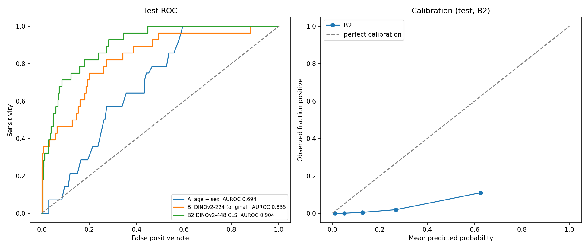

# Detecting hypertensive retinopathy signs in fundus photos with frozen foundation-model embeddings

**TL;DR:** Frozen, self-supervised vision-transformer features plus a logistic regression detect
hypertensive retinopathy signs in single retinal photos. The final model (DINOv2 ViT-B/14 at 448 px,
with CLAHE vessel enhancement) reaches **test AUROC 0.90 (95% CI 0.84–0.95)**, up from **0.83** for
the first version at 224 px and **0.69** for an age + sex baseline. The gain over v1 is
**+0.07 (95% CI 0.01–0.15)**, measured with a patient-level paired bootstrap. The upgrade was
chosen by cross-validation on train + val only, then evaluated on the test set once; this is the
test set's second use (v1 was the first). The test set holds 28 positive images from 15 patients,
so all intervals are wide.

**Live demo:** DEMO_URL (upload a fundus photo, get a rank and a Grad-CAM heatmap)

---

## 1. Question

Hypertension leaves visible traces in the retina: narrowed arterioles, AV nicking and haemorrhages.
Can a general-purpose image model that was **never trained on medical images** pick these up well
enough that a simple linear classifier on its embeddings beats a demographic baseline?

## 2. Data

- **ODIR-5K** (Ocular Disease Intelligent Recognition, Kaggle mirror `andrewmvd/ocular-disease-recognition-odir5k`):
  3,500 patients, two colour fundus photos each (left + right eye), 7,000 images.
  The images are not included in this repository.
- **Label (`H_eye`)**: 1 if *that eye's* diagnostic keywords mention hypertensive retinopathy
  (`"hypertensi"`), else 0. I used the per-eye label, not the per-patient label `H`, because the
  model sees one eye at a time and the label must describe the input. The two labels differ on
  13 images.
- **Very imbalanced**: 193 of 7,000 images are positive (about 2.7%).

### Split (patient-level, stratified)

| split | patients | images | positive images | positive patients |
|-------|---------:|-------:|----------------:|------------------:|
| train | 2,450 | 4,900 | 137 | 72 |
| val   |   525 | 1,050 |  28 | 16 |
| test  |   525 | 1,050 |  28 | 15 |

- 70/15/15 split **by patient**, so both eyes of a person always land in the same split. Otherwise
  the model could recognise the person instead of the disease.
- Stratified on hypertension × diabetes, seed 42.
- Assertions check that no patient ID appears in two splits.

## 3. Method (v1)

1. **Preprocessing**: crop the black border around the circular fundus, pad to square, resize to
   224×224 and normalise with the backbone's ImageNet statistics.
2. **Feature extraction**: `vit_base_patch14_dinov2.lvd142m` (timm) with the classification head
   removed (`num_classes=0`), **frozen** and in eval mode. One forward pass per image gives a
   768-dimensional embedding (stored in `emb_dinov2.npy`, 7000 × 768).
3. **Classifiers**: logistic regression with `class_weight="balanced"`. Each StandardScaler is
   fitted on train only.
   - **A, baseline**: age + sex only
   - **B, image**: 768-d DINOv2 embedding
   - **C, image + demographics**: embedding + age + sex
4. **Model selection on validation only**: regularisation strength `C` swept over
   {1e-4, 1e-3, 1e-2, 0.1, 1} and chosen by validation AUROC. With weak regularisation the
   training AUROC reaches 1.0 while validation drops, which is classic overfitting with
   768 features and only 137 positives.
5. **Operating threshold**: chosen on validation as the lowest threshold reaching sensitivity ≥ 0.85.
6. **Test set used once**, after every setting above was frozen.
7. **Uncertainty**: a 1,000-round **patient-level paired bootstrap** (seed 0). Each round resamples
   patients, not images, because the two eyes of one person are correlated. All models are scored
   on the same resample, so differences between models get their own CIs.

## 4. Results of the first version (v1)

### Validation (used for model selection)

| model | val AUROC | val AP |
|---|---:|---:|
| A: age + sex | 0.602 | 0.043 |
| B: DINOv2 | 0.795 | 0.106 |
| C: DINOv2 + age + sex | 0.796 | 0.105 |

Chance-level AP equals prevalence, about 0.027.

### Test (first evaluation)

| model | test AUROC [95% CI] | test AP | sensitivity | specificity | TP / FN |
|---|---|---:|---:|---:|---:|
| A: age + sex | 0.694 [0.591, 0.784] | 0.047 | 1.000 | 0.194 | 28 / 0 |
| B: DINOv2 | **0.833 [0.738, 0.910]** | **0.354** | 0.821 | 0.691 | 23 / 5 |
| C: DINOv2 + age + sex | 0.839 [0.745, 0.916] | 0.345 | 0.821 | 0.687 | 23 / 5 |

Sensitivity and specificity are at the validation-chosen thresholds (A 0.479, B 0.134, C 0.131).
Test prevalence is 28 / 1,050 = 2.7%.

### Paired differences (bootstrap)

| comparison | ΔAUROC | 95% CI |
|---|---:|---|
| B − A | +0.137 | [0.012, 0.251] |
| C − A | +0.144 | [0.022, 0.254] |
| C − B | +0.007 | [0.000, 0.013] |

### What v1 showed

- **The image carries real signal beyond demographics.** B beats A on the test set and the paired
  CI excludes zero. The lower bound is close to zero, though, so the size of the gain is uncertain.
- **Demographics add nothing in practice.** C − B is statistically consistent but tiny
  (+0.007 AUROC). B and C make almost identical predictions, which makes their paired difference
  very stable and its CI very narrow. The embedding already captures the useful age-related signal.
- **Age alone is a weak signal in this cohort.** On validation, age by itself had AUROC 0.41, which
  is *below* chance. The comparison group is not healthy young people but other eye-clinic
  patients, who are also old. Any image model has to beat a confounded, clinic-population
  baseline, not a population one.
- **One number isn't enough.** Model A reaches sensitivity 1.0 simply by flagging 81% of all
  images. Sensitivity always has to be reported together with specificity.
- **What the operating point means in practice:** at 82% sensitivity, model B flags about a third
  of images. About 7% of flagged images are positive, against a 2.7% base rate. That is a
  2.5× enrichment, useful as a triage or ranking signal, not as a diagnosis.
- **Scores are rankings, not probabilities.** Balanced class weighting makes the model act as if
  half the data were positive, so outputs are inflated. In the highest-scoring fifth of test images
  the mean predicted value is about 0.54, while about 9% are actually positive (right panel above).
  Real probabilities would need recalibration, for example Platt or isotonic scaling on validation.
- **Test is higher than validation (0.83 vs 0.80).** This is small-sample noise, not
  improvement. Model A's validation score of 0.60 falls inside its test CI.

## 5. Upgrade (v2): what improves the model, decided without the test set

### Protocol

- **Development set** = train + val (2,975 patients, 165 positive images). Every comparison used
  5-fold cross-validation **grouped by patient** (`StratifiedGroupKFold`), with the scaler fitted inside
  each fold.
- **36 variants**: 2 backbones × resolution 224/448 px × pooling (CLS, CLS + patch mean) ×
  plain vs **CLAHE** contrast enhancement × with/without horizontal-flip test-time averaging, plus two
  DINOv2 + RETFound combinations. Backbones: `vit_base_patch14_dinov2.lvd142m` and
  [RETFound](https://github.com/rmaphoh/RETFound_MAE) (`RETFound_mae_natureCFP`, ViT-L/16 MAE pretrained
  on ~1.6 M retinal images). Each variant got its own regularisation sweep (C from 1e-4 to 3e-2).
- **Selection rule, fixed before running:** highest mean CV AUROC; among variants within 0.01 of the
  best, the cheapest one (fewest forward passes, fewest features) wins.
- **Final model** refitted on all of train + val. Its threshold (first point with sensitivity ≥ 0.85)
  comes from out-of-fold CV scores, so the test set plays no part in it.
- **Reproduction check:** the pipeline re-creates the exact v1 split (same fingerprint) and v1's
  validation AUROCs (A 0.602, B 0.795).

### What each change did (CV AUROC, train + val)

| change | effect on CV AUROC |
|---|---:|
| resolution 224 → 448 px (DINOv2) | **+0.017** |
| CLAHE vessel enhancement (avg. over matched variants) | **+0.012** |
| CLS → CLS + patch mean (DINOv2, 448 px) | +0.004 |
| flip test-time averaging | +0.001 |
| best DINOv2 → best RETFound | **−0.064** |
| resolution 224 → 448 px (RETFound) | −0.003 |

| variant | features | CV AUROC (± fold SD) |
|---|---:|---:|
| DINOv2-448 CLS + mean, CLAHE, flip | 1536 | 0.842 ± 0.033 |
| DINOv2-448 CLS + mean, CLAHE | 1536 | 0.841 ± 0.031 |
| **DINOv2-448 CLS, CLAHE (selected: within 0.01, half the features)** | **768** | **0.837 ± 0.033** |
| DINOv2-448 CLS, plain | 768 | 0.830 ± 0.035 |
| DINOv2-224 CLS, plain (= v1 recipe) | 768 | 0.818 ± 0.036 |
| best DINOv2 + RETFound combination | 2560 | 0.834 ± 0.025 |
| best RETFound alone (448 px, mean, CLAHE, flip) | 1024 | 0.778 ± 0.044 |

All 36 rows: [`results/cv_results.csv`](results/cv_results.csv).

### Test results (second and final use of the test set)

| model | test AUROC [95% CI] | test AP | sensitivity | specificity | TP / FN / FP |
|---|---|---:|---:|---:|---:|
| A: age + sex | 0.694 [0.591, 0.784] | 0.047 | 1.000 | 0.194 | 28 / 0 / 824 |
| B: v1, DINOv2-224 CLS | 0.835 [0.742, 0.914] | 0.373 | 0.821 | 0.703 | 23 / 5 / 304 |
| **B2: v2, DINOv2-448 CLS + CLAHE** | **0.904 [0.841, 0.954]** | 0.259 | **0.964** | 0.624 | 27 / 1 / 384 |

| paired difference | ΔAUROC | 95% CI |
|---|---:|---|
| B2 − B | **+0.070** | [0.013, 0.146] |
| B2 − A | +0.210 | [0.116, 0.312] |
| B − A | +0.140 | [0.014, 0.253] |

B here is v1 re-run inside the new pipeline (0.835 vs 0.833 originally; the small gap comes from
slightly different image decoding and resizing).

## 6. Interpretation

- **Detail matters.** Hypertensive signs are thin vessels and arteriovenous crossings. At 224 px a
  ~2,000 px photo shrinks about 9×; at 448 px, 4.5×. Higher resolution and vessel-contrast
  enhancement were the two changes that helped, and they point the same way.
- **The retina-specific model lost.** RETFound was 0.06 AUROC behind DINOv2 in every setting. The
  likely reason is how it was pretrained: masked-autoencoder (MAE) features are known to be weak for
  *frozen* linear probes and are meant to be fine-tuned, which is how the RETFound paper uses them.
  DINOv2 is trained so that its frozen features work directly. A domain-specific model is not
  automatically better; how it was trained decides how it can be used.
- **Ranking improved overall, but not at the very top.** AUROC rose to 0.90 and the threshold now
  catches 27 of 28 positives, yet average precision fell (0.37 → 0.26). The images B2 is *most*
  confident about include more false positives than v1's top picks. For a screening use (catch
  nearly everyone, then look closer) B2 is better; for "show me only the surest cases" v1 is not
  worse. At B2's threshold about 39% of images are flagged and 6.6% of flagged images are positive
  (2.5× the base rate).
- **Grad-CAM** on the final model highlights the major vessel arcades on the correctly detected
  cases. The top false positive shows scattered, grid-like hot spots instead: typical of ViT
  token artefacts and a reminder that a heatmap is a hint, not proof of what the model uses.
- **Scores are still rankings, not probabilities** (right panel above): the balanced class
  weighting inflates them. The demo therefore shows "ranks above X% of test images", never a
  percentage risk.
- **Demographics add nothing** (v1: C − B = +0.007 AUROC), and **age alone is below chance** in this
  eye-clinic cohort (val AUROC 0.41), because the comparison patients are old too.

## 7. Limitations

- **Small number of positives**: 28 test images from 15 patients, so about 15 independent positive
  cases; hence the wide CIs.
- **The test set has now been used twice** (v1, then v2). The v2 choice was made on cross-validation
  alone, but 36 variants were compared, so the CV numbers of the winner are slightly optimistic.
- **Labels come from free-text diagnostic keywords**, not blood-pressure measurements: they capture
  visible hypertensive retinopathy as noted by graders, and some mild cases are probably unlabelled.
- **Single dataset, no external validation.** ODIR comes from a few Chinese hospitals and several
  camera models.
- **Eye-clinic cohort**: most negatives have other eye diseases; not a screening population.
- **Frozen backbones, linear head**: fine-tuning (especially of RETFound) was not tried.

## 8. Next steps

- Fine-tune RETFound and DINOv2 end to end and compare with these frozen baselines.
- Recalibrate scores on development data (Platt or isotonic) to report real probabilities.
- Evaluate on an external fundus dataset.
- Follow-up project: how much patient identity these embeddings leak (can the left and right eye of
  one person be linked?) and whether it can be removed without losing diagnostic signal.

## 9. Reproduce and files

v2 runs as one script on a Kaggle GPU notebook (T4), about 40 minutes:

1. Attach ODIR-5K, enable internet, and attach a Hugging Face read token as the Kaggle secret
   `HF_TOKEN` (RETFound is gated; request access on its model page first).
2. Put `model.py` and `upgrade.py` in one folder and run `pip install grad-cam && python upgrade.py`.

| path | contents |
|---|---|
| `make_split.py` | v1 patient-level split (v2 rebuilds the identical split internally) |
| `upgrade.py` | v2 pipeline: features, 36-variant CV, final model, test, bootstrap, Grad-CAM |
| `model.py` | shared preprocessing (crop, CLAHE), backbone loading, folded PyTorch model, Grad-CAM |
| `streamlit_app.py`, `head.json`, `requirements.txt` | the live demo (weights of the logistic head, test-score distribution for the rank) |
| `results/` | v1 and v2 result tables, CV table, figures |

**Stack:** Python, PyTorch, timm, scikit-learn, pytorch-grad-cam, OpenCV, Streamlit.
